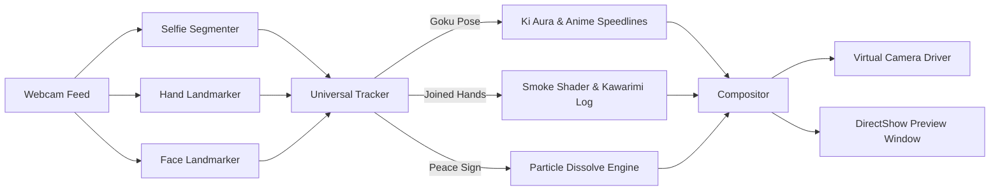

# VanishCam 消失

<p align="center">
  
</p>

<p align="center">
  <strong>The Ultimate AI-Powered Real-Time Meme & Disappearance Webcam Suite</strong>
</p>

<p align="center">
  
  
  
  
  
  
</p>

---

## Overview

**VanishCam** is a high-performance, real-time computer vision application that brings legendary anime memes to your webcam feed. Powered by MediaPipe 3D gesture and landmark tracking and selfie segmentation, VanishCam lets you trigger visual effects, sounds, and disappearances on the fly during live calls and streams.

All processing runs **100% locally on your machine**. Video is never uploaded or recorded. The Mac app saves one private calibration background image for reuse. The feed outputs cleanly to Zoom, Google Meet, Discord, Microsoft Teams, and OBS Studio without watermarks, overlays, or UI clutter.

---

## Meme Modes

VanishCam features an **All-In-One Universal Mode** where every meme gesture is active concurrently without manual switching:

### 1. Goku Instant Transmission (Shunkan Ido)
- **Gesture**: Touch two joined fingers (index and middle) to your forehead or temple.
- **Visuals**: Charges an animated Ki aura with lightning crackles, then bursts into vertical manga speed lines as you vanish instantly.
- **Reappearance**: Reappear with the same gesture after a 2-second cooldown, or use the `R` key.
- **Sound**: Authentic DBZ teleport sound effect.

### 2. Naruto Substitution Jutsu (Kawarimi no Jutsu)
- **Gesture**: Bring both palms firmly together in front of your chest in the classic ninja hand seal.
- **Visuals**: Instant puff of volumetric smoke as you dissolve, leaving behind an original anime-style wooden substitution log that falls and rests on the ground.
- **Sound**: Authentic ninja vanish sound effect.

### 2b. Instant Transmission Travel
- **Setup**: Choose any landscape image as a destination (**Choose destination…** in the Mac app, or `--destination-file PATH`).
- **Gesture**: The Goku gesture travels instead of vanishing while a destination is set; repeat it to come home. Key `4` or **Travel** does the same.
- **Visuals**: A flash and zoom blur leave the current place, then the destination rushes in behind you while you stay visible. The destination shifts slightly as you move so the camera feels like it came with you.
- **Note**: Travel does not need a saved background. Lighting is not matched to the destination.

### 3. Normal Dissolve Vanish
- **Gesture**: Flash a steady, still Peace Sign (V-sign) with one hand.
- **Visuals**: Shimmering particle dissolve with a cyan edge glow, seamlessly blending your silhouette into the captured background.

---

## Live Call & Streaming Integration

VanishCam integrates seamlessly with all major streaming and conferencing software:

- **Virtual Camera**: Automatically creates an **OBS Virtual Camera** or **Unity Capture** device on launch. Simply select the virtual camera as your video input in Discord, Zoom, Google Meet, Teams, or Skype.
- **OBS Studio Window Capture**: Select the clean window `Webcam - Preview` as an OBS source with zero latency.

---

## Quick Start

### Prerequisites
- Windows 10/11
- Python 3.10, 3.11, or 3.12 (Python 3.11 recommended)
- A connected webcam

### macOS with Camo Studio

**Standalone Mac app (Apple silicon):** run `./Build-macOS.command` to build
`dist/macos/VanishCam.app`, then open that app in Finder. Building requires
Python 3.12, FFmpeg, and Apple's Swift command-line tools; running the resulting
app does not. The app bundles the Python runtime, models, audio, FFmpeg, and its
libraries. An enabled OBS camera extension remains required; Camo does not.
This is a local ad-hoc-signed build, not a notarized distribution.
macOS may request camera permission again after rebuilding/replacing this
ad-hoc-signed app because its code identity changes. Opening the unchanged app
does not rebuild it; keep using that installed copy for normal launches.

The app has a normal Dock icon and a single controls/preview window. It captures
**Logitech or the Mac built-in camera directly**; Camo is not required.
Alternatively select **Camo Camera** to use Camo Studio's framing and camera
adjustments; keep Camo Studio running in that mode. Camo is an explicit input,
never a fallback. It uses the same timestamp-passthrough capture fix as the
physical cameras, and its output is not mirrored. Its settings and backgrounds
are stored separately from direct Logitech/Mac profiles. Leave VanishCam zoom
at 1x if you want all framing to come from Camo. Changing framing inside Camo
requires a manual background reset, since VanishCam cannot detect that change.

**Call controls:** Every Start uses **Normal video**, keeping the selected camera,
framing, preview, and OBS output live with effects and hand gestures off.
Check **Enable effects** to use effect buttons; **Enable hand gestures** is a
separate opt-in checkbox. Unchecking Enable effects immediately restores normal
video without stopping the virtual camera, even during an effect or calibration.
Use this instead of Stop when you just want an ordinary call camera.
In the app's all-in-one mode, gestures require a stable **0.9-second hold**.
Release to a neutral pose for **0.4 seconds** before another gesture can trigger;
continuing to hold the same pose will not repeatedly toggle disappearance.
Detection gaps and hand movement restart the hold. Goku also requires a currently
visible face, rather than guessing the forehead from screen position. The
all-in-one detector uses stricter hand confidence and no cropped-view retries.
Buttons remain immediate and do not require a gesture hold.
**Stop VanishCam** disconnects the camera/output; Teams may display a frozen or
blank frame afterward.

For WhatsApp Desktop, select **OBS Virtual Camera** while VanishCam is running
and its preview shows live **Normal video**. Keep OBS Studio's own stream stopped.
If WhatsApp stays black or frozen while VanishCam is live, reselect the camera;
if needed, quit and reopen WhatsApp after starting VanishCam. A working local
preview alone does not establish that WhatsApp is receiving frames. Do not stop
VanishCam during the call unless you intend to disconnect its output.

Background capture is explicit only in the packaged app. **Reset background**
is available while running with effects enabled; step out for four seconds.
Starting, switching modes, changing framing, or invalidating a background never
automatically captures a replacement. Effects wait for an explicit reset if the
saved background is missing or incompatible. Stale reset requests are discarded
on launch.
**Start** opens the selected camera and sends video to OBS; **Stop** releases both. **Dissolve**, **Naruto**,
**Goku**, **Show myself**, and **Reset background** work without keyboard focus.
The **VC** menu-bar item also provides Start/Stop, effects and gesture toggles,
all three effect buttons, Show myself, and Reset background. Bartender can hide
and reveal this item like other menu-bar controls; search for **VC** in Bartender
if it is hidden. **Hide preview** closes the window without stopping video.
The app remembers whether the window was closed for the next launch.
Use **Open controls** or click the Dock icon to reopen it, or use **Quit VanishCam**
to stop and exit. It never starts video automatically. The Dock controls remain
available if Bartender cannot reveal the item.

Choose a camera and a supported **capture resolution / FPS** while stopped.
The default is 1920×1080 at 30 fps when advertised by the camera. The list comes
from the camera's supported modes, not assumed capabilities. Click **Refresh
cameras** after connecting/disconnecting devices. Your last selection is remembered;
an unavailable camera never silently falls back to another.
The MacBook lid must be open to use its built-in camera, even if it is still
listed while the lid is closed.

**Zoom**, **Horizontal**, and **Vertical** adjust digital crop/framing live and
are saved per camera. Capture, effects, and OBS output all use the selected
resolution, so higher modes look sharper but cost more CPU. Changing modes
requires **Reset background** before using effects. Non-widescreen
input is cropped to fit without stretching. These are digital controls, not
hardware focus/exposure/white-balance controls, and no color filters are included.

On a new camera or after changing framing, live video is available immediately,
but effects wait for **Reset background**. Step out for four seconds; the status
confirms **Background saved**. Backgrounds are separate per camera and capture
mode, and are reused only when framing matches. Camo backgrounds are not reused.

The standalone app keeps preferences, camera profiles/backgrounds, and its text-only
launch log in `~/Library/Application Support/VanishCam/`. Live preview frames
travel through an in-memory pipe, not image files. The app can be moved without
breaking its resource paths. Camo need not run, and its settings are unchanged.

**Development launcher (external Python):**
For a menu-bar Start/Stop button, double-click `VanishCam-Menu.command` once.
The app also opens a **VanishCam controls** window with the same Start, Stop,
Show myself, and Reset background actions. Reopening the app brings this window
forward; **Open controls** in the VC menu does the same. Closing the window does
not stop the camera or quit the menu-bar app.
It builds and opens a native menu-bar app (requires Apple's Swift command-line tools).
Choose **Start VanishCam** or **Stop VanishCam** from its menu. The app stays in
the menu bar until you quit it; it does not auto-start at login or change Teams.
If macOS asks, allow camera access for VanishCam. Launch errors are shown in an
alert, with a text-only log available through **Open launch log**.

The Mac launcher saves one calibration image privately in `.local-state/background.png`
(ignored by Git) and reuses it on subsequent starts. **Reset background** in the
menu, or **Space** in the preview, captures and saves a replacement after four
seconds. Step out of frame during capture. If the camera resolution changes,
VanishCam requests a new calibration. Otherwise reset manually when camera
position, room lighting, or background changes. No video is recorded or uploaded.

Choose **Show myself** from the VC menu to restore live video immediately,
even if the preview is hidden or another app has keyboard focus. This preserves
the saved background and bypasses the Goku return cooldown.

1. Keep Camo Studio running with the Logitech camera selected.
2. Install OBS Studio, then start and stop **OBS Virtual Camera** once in OBS and quit OBS. This registers the macOS camera extension required by `pyvirtualcam`. If System Settings reports the extension is waiting for approval, approve it there and restart if prompted.
3. Install Homebrew Python 3.12 and FFmpeg if they are not already installed.
4. Run `./VanishCam.command` from this repository, or double-click it in Finder. It creates an isolated `.venv-local` environment, installs the dependencies, selects **Camo Camera** by name, and outputs to **OBS Virtual Camera** without mirroring the Camo image.
5. If macOS asks for camera access, allow it for the app launching the command. In Teams, select **OBS Virtual Camera** yourself; this setup does not change Teams or Camo settings.

The launch command stops with an error if Camo Camera is missing, rather than switching to FaceTime or another camera. Quit VanishCam with `Q` or `ESC`; do not stream from OBS at the same time.

Named Mac input is captured directly through FFmpeg's AVFoundation backend
and resized to the requested processing size, avoiding OpenCV capture failures
with Camo's advertised native mode. When launching from Terminal, grant camera
access to **Terminal** if requested; the menu-bar app may require its own permission.
Named capture uses FFmpeg timestamp passthrough to avoid duplicating a startup
frame instead of delivering live video.
Capture is continuously drained on a reader thread with a single latest-frame
slot. Slow effects processing drops intermediate input frames instead of queuing
old video, including while models initialize. Capture errors still stop the app;
the last frame is not reused as a success-shaped fallback.

### Installation

1. **Clone the repository**:
   ```bash
   git clone https://github.com/Schtechel/VanishCam.git
   cd VanishCam
   ```
   This fork adds the native macOS app and travel mode to the original
   [tanmayybuilds/VanishCam](https://github.com/tanmayybuilds/VanishCam).

2. **Launch with One Click (Windows Batch Launchers)**:
   - **`START_ALL_CAMERAS.bat`**: Universal All-In-One Mode (Recommended).
   - **`START_GOKU.bat`**: Direct launch into Goku Instant Transmission mode.
   - **`START_NARUTO.bat`**: Direct launch into Naruto Substitution mode.
   - **`START_NORMAL.bat`**: Direct launch into Normal Dissolve mode.
   - **`START_OBS.bat`**: Clean preview window for OBS Window Capture.

   *First run `local_app\START_LOCAL.bat` once: it creates the local `.venv-local` virtual environment and installs all dependencies. The other launchers expect that environment to exist.*

3. **Or run manually with Python**:
   ```bash
   python -m venv .venv
   .venv\Scripts\activate
   pip install -r requirements.txt
   python local_app/vanish_cam.py --mode all
   ```

---

## How It Works: The 4-Second Calibration

1. When you launch VanishCam, **step out of the camera frame for 4 seconds**.
2. The system computes a median background frame from multiple clean camera samples.
3. The console notifies you when background calibration is complete (`Background ready. You can re-enter the frame.`).
4. Step back into view — you're ready to perform any meme move!

---

## Controls & Shortcuts

| Key | Action |
| :---: | :--- |
| **`SPACE`** | Recalibrate background (step out of frame for 4s) |
| **`R`** | Reappear manually / reset state |
| **`1`** | Manually trigger Normal Dissolve vanish (or reappear) |
| **`2`** | Manually trigger Naruto Substitution Jutsu (or reappear) |
| **`3`** | Manually trigger Goku Instant Transmission (or reappear) |
| **`4`** | Travel to the destination image (or come home) |
| **`C`** | Cycle to next available webcam index (0, 1, 2, ...) |
| **`F`** | Toggle Fullscreen window |
| **`Q` / `ESC`** | Quit application and release camera devices |

---

## Command Line Options

```text
python local_app/vanish_cam.py [OPTIONS]

Options:
  --mode {all,normal,naruto,goku}  Effect mode (default: all)
  --camera INT                     Webcam device index (default: 0)
  --camera-name NAME              Select an AVFoundation camera by name (macOS)
  --width INT                      Capture width (default: 960)
  --height INT                     Capture height (default: 540)
  --fps FLOAT                      Virtual camera max FPS (default: 30.0)
  --no-mirror                      Disable horizontal mirroring
  --no-virtual-camera              Disable virtual camera driver output
  --menu                           Show interactive startup mode selection menu
  --gesture-debug                  Print real-time tracking diagnostics in console
  --destination-file PATH          Image to travel to with Instant Transmission
  --self-test                      Verify model assets and audio pipeline offline
```

---

## Technical Architecture



- **Robust Gesture Disambiguation**: Hand geometries are normalized against palm scale and knuckle vector directions, ensuring that moving hands or individual fingers do not cause cross-triggering between gestures.
- **Stillness Verification**: The peace sign requires a 0.25-second stationary hold, preventing false positives when hands enter or exit the frame.
- **Procedural FX Engine**: Smoke particles, anime warp lines, and Ki charge auras are rendered procedurally in OpenCV/NumPy for zero latency and dynamic bounding-box scaling.

---

## Running Tests

VanishCam includes a full unit test suite covering gesture mathematics, landmark invariants, compositing pipelines, and video output loops:

```bash
python -m unittest discover -s local_app -p "test_*.py"
```

To run offline model and asset validation:
```bash
python local_app/vanish_cam.py --self-test
```

---

## Building a Standalone Windows Executable

To compile a self-contained `.exe` without requiring Python on the target machine:

```cmd
cd local_app
BUILD_WINDOWS.bat
```

The resulting executable will be generated at `local_app\dist\VanishCam.exe`.

---

## License

Distributed under the MIT License. See [LICENSE](LICENSE) for details.

---

<p align="center">
  Built with ❤️ by <a href="https://github.com/tanmayybuilds">Tanmay</a>
</p>
