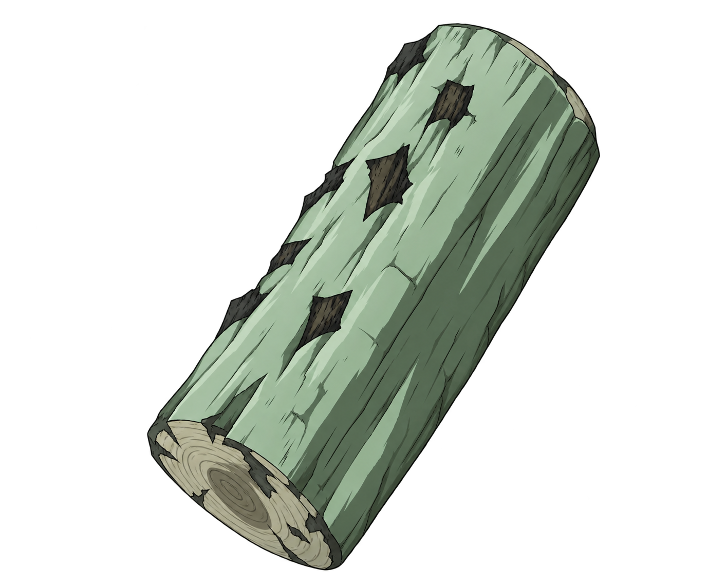
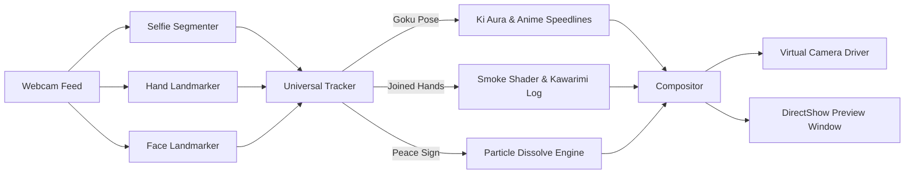

# VanishCam 消失

<p align="center">
  
</p>

<p align="center">
  <strong>The Ultimate AI-Powered Real-Time Meme & Disappearance Webcam Suite</strong>
</p>

<p align="center">
  
  
  
  
  
  
</p>

---

## Overview

**VanishCam** is a high-performance, real-time computer vision application that brings legendary anime memes to your webcam feed. Powered by MediaPipe 3D gesture and landmark tracking and selfie segmentation, VanishCam lets you trigger visual effects, sounds, and disappearances on the fly during live calls and streams.

All processing runs **100% locally on your machine**. Frames are never stored, sent to the cloud, or recorded. The feed outputs cleanly to Zoom, Google Meet, Discord, Microsoft Teams, and OBS Studio without watermarks, overlays, or UI clutter.

---

## Meme Modes

VanishCam features an **All-In-One Universal Mode** where every meme gesture is active concurrently without manual switching:

### 1. Goku Instant Transmission (Shunkan Ido)
- **Gesture**: Touch two joined fingers (index and middle) to your forehead or temple.
- **Visuals**: Charges an animated Ki aura with lightning crackles, then bursts into vertical manga speed lines as you vanish instantly.
- **Reappearance**: Reappear with the same gesture after a 2-second cooldown, or use the `R` key.
- **Sound**: Authentic DBZ teleport sound effect.

### 2. Naruto Substitution Jutsu (Kawarimi no Jutsu)
- **Gesture**: Bring both palms firmly together in front of your chest in the classic ninja hand seal.
- **Visuals**: Instant puff of volumetric smoke as you dissolve, leaving behind an original anime-style wooden substitution log that falls and rests on the ground.
- **Sound**: Authentic ninja vanish sound effect.

### 3. Normal Dissolve Vanish
- **Gesture**: Flash a steady, still Peace Sign (V-sign) with one hand.
- **Visuals**: Shimmering particle dissolve with a cyan edge glow, seamlessly blending your silhouette into the captured background.

---

## Live Call & Streaming Integration

VanishCam integrates seamlessly with all major streaming and conferencing software:

- **Virtual Camera**: Automatically creates an **OBS Virtual Camera** or **Unity Capture** device on launch. Simply select the virtual camera as your video input in Discord, Zoom, Google Meet, Teams, or Skype.
- **OBS Studio Window Capture**: Select the clean window `Webcam - Preview` as an OBS source with zero latency.

---

## Quick Start

### Prerequisites
- Windows 10/11
- Python 3.10, 3.11, or 3.12 (Python 3.11 recommended)
- A connected webcam

### Installation

1. **Clone the repository**:
   ```bash
   git clone https://github.com/tanmayybuilds/VanishCam.git
   cd VanishCam
   ```

2. **Launch with One Click (Windows Batch Launchers)**:
   - **`START_ALL_CAMERAS.bat`**: Universal All-In-One Mode (Recommended).
   - **`START_GOKU.bat`**: Direct launch into Goku Instant Transmission mode.
   - **`START_NARUTO.bat`**: Direct launch into Naruto Substitution mode.
   - **`START_NORMAL.bat`**: Direct launch into Normal Dissolve mode.
   - **`START_OBS.bat`**: Clean preview window for OBS Window Capture.

   *The batch launchers automatically configure a local `.venv-local` virtual environment and install all dependencies on the first run.*

3. **Or run manually with Python**:
   ```bash
   python -m venv .venv
   .venv\Scripts\activate
   pip install -r requirements.txt
   python local_app/vanish_cam.py --mode all
   ```

---

## How It Works: The 4-Second Calibration

1. When you launch VanishCam, **step out of the camera frame for 4 seconds**.
2. The system computes a median background frame from multiple clean camera samples.
3. The console notifies you when background calibration is complete (`Background ready. You can re-enter the frame.`).
4. Step back into view — you're ready to perform any meme move!

---

## Controls & Shortcuts

| Key | Action |
| :---: | :--- |
| **`SPACE`** | Recalibrate background (step out of frame for 4s) |
| **`R`** | Reappear manually / reset state |
| **`1`** | Manually trigger Normal Dissolve vanish (or reappear) |
| **`2`** | Manually trigger Naruto Substitution Jutsu (or reappear) |
| **`3`** | Manually trigger Goku Instant Transmission (or reappear) |
| **`C`** | Cycle to next available webcam index (0, 1, 2, ...) |
| **`F`** | Toggle Fullscreen window |
| **`Q` / `ESC`** | Quit application and release camera devices |

---

## Command Line Options

```text
python local_app/vanish_cam.py [OPTIONS]

Options:
  --mode {all,normal,naruto,goku}  Effect mode (default: all)
  --camera INT                     Webcam device index (default: 0)
  --width INT                      Capture width (default: 960)
  --height INT                     Capture height (default: 540)
  --fps FLOAT                      Virtual camera max FPS (default: 30.0)
  --no-mirror                      Disable horizontal mirroring
  --no-virtual-camera              Disable virtual camera driver output
  --menu                           Show interactive startup mode selection menu
  --gesture-debug                  Print real-time tracking diagnostics in console
  --self-test                      Verify model assets and audio pipeline offline
```

---

## Technical Architecture



- **Robust Gesture Disambiguation**: Hand geometries are normalized against palm scale and knuckle vector directions, ensuring that moving hands or individual fingers do not cause cross-triggering between gestures.
- **Stillness Verification**: The peace sign requires a 0.25-second stationary hold, preventing false positives when hands enter or exit the frame.
- **Procedural FX Engine**: Smoke particles, anime warp lines, and Ki charge auras are rendered procedurally in OpenCV/NumPy for zero latency and dynamic bounding-box scaling.

---

## Running Tests

VanishCam includes a full unit test suite covering gesture mathematics, landmark invariants, compositing pipelines, and video output loops:

```bash
python -m unittest discover -s local_app -p "test_*.py"
```

To run offline model and asset validation:
```bash
python local_app/vanish_cam.py --self-test
```

---

## Building a Standalone Windows Executable

To compile a self-contained `.exe` without requiring Python on the target machine:

```cmd
cd local_app
BUILD_WINDOWS.bat
```

The resulting executable will be generated at `local_app\dist\VanishCam.exe`.

---

## License

Distributed under the MIT License. See [LICENSE](LICENSE) for details.

---

<p align="center">
  Built with ❤️ by <a href="https://github.com/tanmayybuilds">Tanmay</a>
</p>
